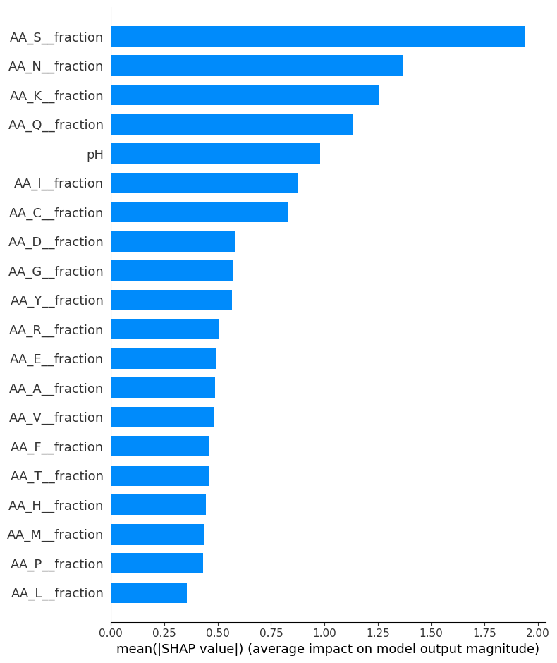
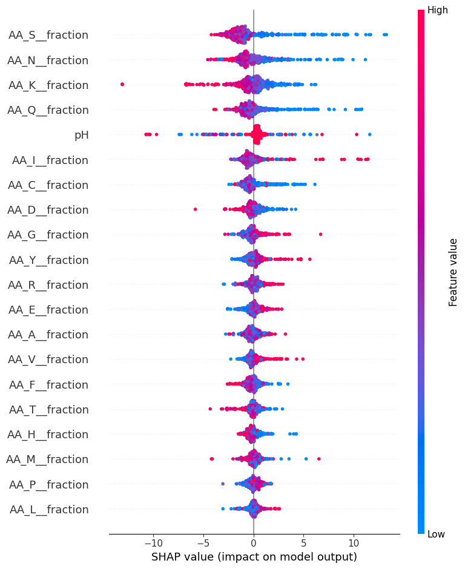
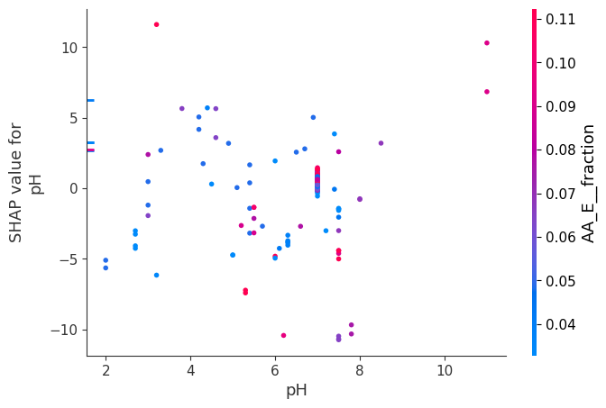

# 🧬 Novozymes Enzyme Stability Prediction Using XGBoost and Explainable AI

## Overview
This project addresses the **prediction of enzyme thermal stability (Tm)** based on protein sequences and environmental factors. Leveraging **machine learning (XGBoost)** and **Explainable AI (SHAP values)**, we built an interpretable predictive model using data from the **Novozymes Enzyme Stability Kaggle dataset**. 

Missense mutations and environmental factors like pH critically affect enzyme stability, making this a key task in protein engineering and biotechnology.

---

## 📂 Dataset
- **Source**: [Novozymes Enzyme Stability Prediction](https://www.kaggle.com/competitions/novozymes-enzyme-stability-prediction)
- **Files Used**:
  - `train.csv`: Contains protein sequences, pH values, data sources, and target Tm.
  - `test.csv`: Sequences for prediction.
  - `test_labels.csv`: Labeled Test dataset
  - `wildtype_structure_prediction_af2.pdb`: Protein structure for mutation analysis.
  - Generated: `AF70_mutations.txt` & `wildtype_af70.fasta` for mutation tracking.

- **Target Variable**: `tm`: Melting temperature of enzymes (°C).

---

## 🚀 Methodology

### 1. **Data Engineering**
- Extracted features:
  - **Amino Acid Counts & Fractions** for all 20 standard amino acids.
  - Sequence length (`n_AA`).
  - Environmental pH handling and correction.
  - Encoded data source as an integer (created but not used as a model feature).
- Addressed pH anomalies (pH and Tm swapped back where pH > 14).

### 2. **Exploratory Data Analysis (EDA)**
- Visualized:
  - Distribution of `tm` and `pH`.
  - Sequence length variability.
  - Spearman correlations between amino acid composition and stability.

### 3. **Mutation Analysis**
- Applied **Levenshtein distance** to detect substitutions, insertions, deletions relative to wildtype.
- Wrote the test mutations and the wildtype sequence to `AF70_mutations.txt` and `wildtype_af70.fasta` for later structure-based analysis.

### 4. **Modeling**
- **Algorithm**: `XGBoost Regressor`
- Features: counts and fractions of the 20 amino acids, sequence length and pH (42 features).
- Validation: **Repeated K-Fold Cross-Validation** (10 folds, 3 repeats).
- **Metric**: Mean Absolute Error (MAE).

### 5. **Explainable AI (XAI)**
- Applied **SHAP (SHapley Additive exPlanations)** for global and local interpretability.
- Generated:
  - Feature Importance Bar Plot.
  - SHAP Summary Plot (beeswarm).
  - SHAP Dependence Plot for interaction insights.

---

## 📊 Results

### 🔹 Model Performance
| Metric | Value |
|---|---|
| Cross-validated MAE (10-fold x 3, training data) | 6.016 ± 0.116 °C |
| Training MAE (in-sample) | 1.988 °C |
| **Spearman correlation with `test_labels.csv`** | **-0.03** (p = 0.10) |

The gap between training and cross-validated MAE shows overfitting. More importantly, on the test set the predictions have **no rank correlation** with the true melting temperatures (Spearman was the competition metric). The test set contains single mutations of one enzyme, and whole-sequence amino acid fractions barely change between these variants, so this feature set cannot rank them. The Spearman value was computed from `submission.csv` and `test_labels.csv` in this repository.

---

### 🔹 SHAP Analysis

#### 1. Global importance

Serine (S), asparagine (N), lysine (K) and glutamine (Q) fractions and pH are the five most influential features.

#### 2. Summary plot

* **Lower** serine, asparagine and glutamine fractions push predicted Tm **up**; higher fractions push it down.
* Higher lysine fraction pushes predicted Tm down; higher isoleucine fraction pushes it up.
* Most pH values sit near 7 with small effects; the large pH effects come from a small number of non-neutral samples.

These describe what the model learned from the training data. They are associations, not causal effects of amino acids on stability.

#### 3. Dependence plot for pH

The pH effect is scattered, with no clear trend across glutamic acid content, so no firm interaction can be read from this plot.

---

## ⚠️ Limitations

* Amino acid composition ignores the position and structural context of a mutation, which is what matters for the single-mutant test set.
* Random K-fold splits put similar or related sequences in both training and validation folds, so the CV MAE is optimistic.
* `test_labels.csv` was not used inside the notebook; the test result above was added afterwards.

---

## 📈 Conclusion
This project builds a composition-based XGBoost baseline for enzyme melting temperature and explains it with SHAP. It fits the training data but does not rank the single-mutant test variants, which shows that mutation-level and structural features are needed for this task.

---

## 🔮 Future Work
- **Integrate Structural Features**: Use AlphaFold-derived metrics (e.g., solvent accessibility, secondary structure elements) for richer feature sets.
- **Deep Learning Approaches**: Explore sequence-based models (e.g., Transformers for proteins).
- **Enhanced Interpretability**: Apply **LIME** for localized instance explanations and compare with SHAP.
- **Transfer Learning**: Fine-tune pretrained bioinformatics models for stability tasks.
- **Experimental Validation**: Collaborate with wet-lab teams to validate high-impact predictions.
